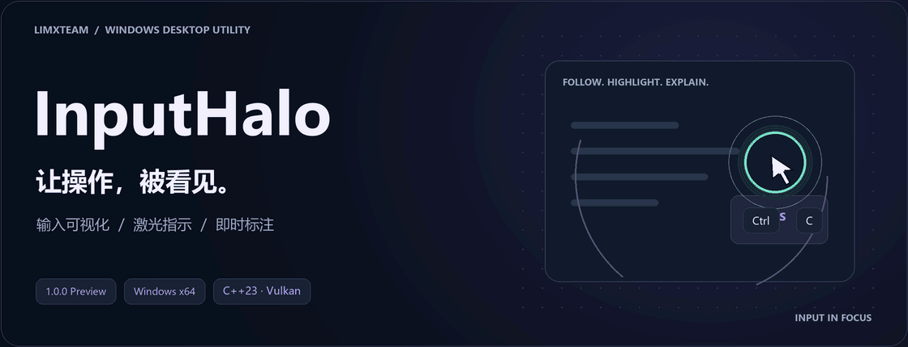
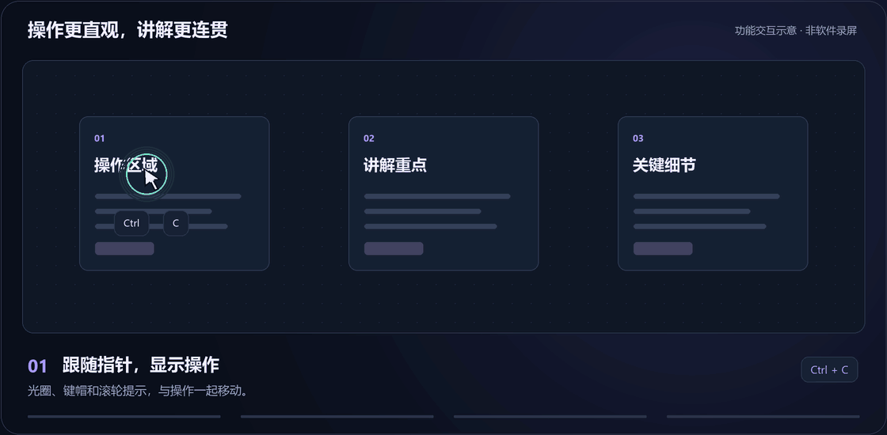
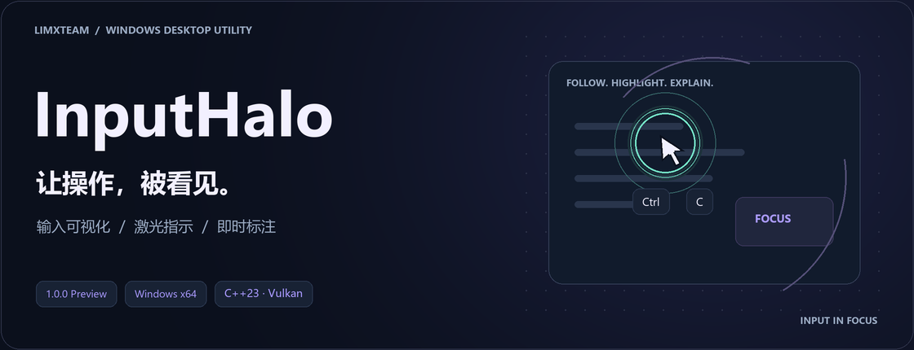
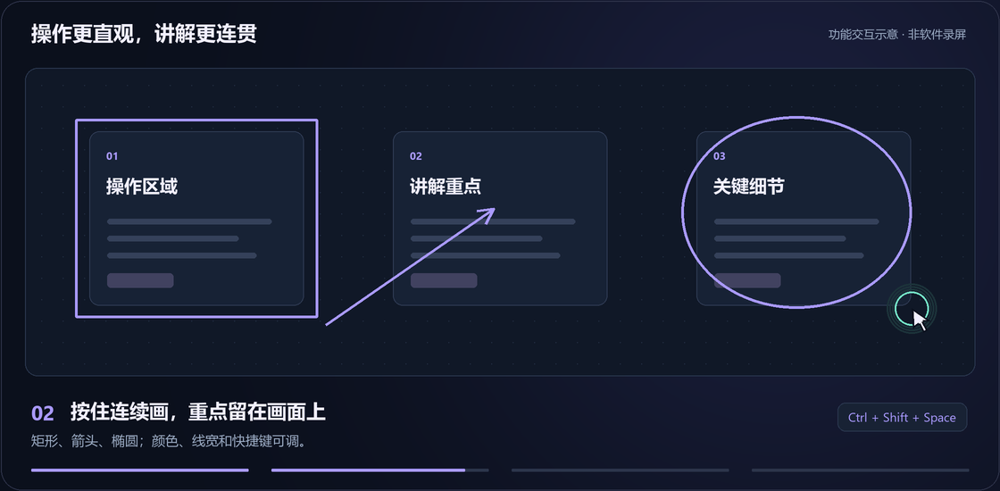
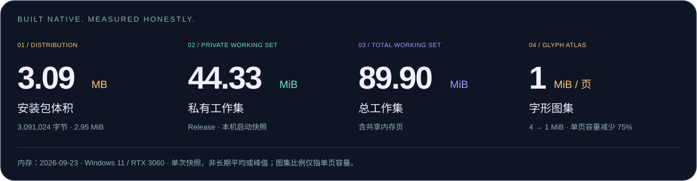

<p align="center">
  
</p>

<p align="center">
  <strong>鼠标有焦点，快捷键有提示，讲解有重点。</strong><br>
  LimxTeam 出品的 Windows 输入可视化与屏幕标注工具。
</p>

<p align="center">
  <a href="https://github.com/LimxTeam/InputHalo/releases"><strong>下载安装</strong></a> ·
  <a href="#showcase">动态展示</a> ·
  <a href="#performance">运行数据</a> ·
  <a href="#features">功能介绍</a> ·
  <a href="#quick-start">快速上手</a> ·
  <a href="#development">开发构建</a>
</p>

---

InputHalo 把操作过程直接呈现在画面上：光圈跟随指针，键帽显示快捷键，点击留下波纹；需要强调时，按住快捷键就能画框、箭头和椭圆，松开即清空。适用于**软件教学、操作录屏、线上会议和现场演示**。

当前版本：**1.0.0 Preview**。原生 **C++23 / Win32 / Vulkan** 实现，支持中文与英文，关闭设置后收起到系统托盘。

<a id="showcase"></a>

## 从跟随指针，到讲清重点

<p align="center">
  
</p>

<p align="center">
  <strong>跟随显示 → 连续标注 → 撤销与清空 → 激光引导</strong><br>
  <sub>动图为已实现功能的交互示意，不是软件录屏；动画节奏不代表实测帧率或延迟。</sub>
</p>

<details>
<summary>静态预览</summary>





</details>

<a id="performance"></a>

## 原生实现，用数字说话

<p align="center">
  
</p>

**约 3 MB 的安装包，包含输入提示、鼠标高亮、激光、三种标注、配置方案与中英文设置。** 运行时无需嵌入浏览器或 WebView；图形由 Vulkan 绘制，经共享纹理交给 D3D11 / DirectComposition 完成桌面透明合成，产品渲染路径不进行 CPU 像素读回。

**44.33 MiB 私有工作集、89.90 MiB 总工作集**来自已有的本机 Release 启动快照。内存优化已经落实到字体共享映射、按需增长的字形图集、上传缓冲回收和隐藏窗口的绘图资源释放。

<sub>内存采样于 2026-09-23：Windows 11、RTX 3060、3840 × 2160 显示模式，含虚拟显示适配器，程序检测到两个显示器；设置窗口渲染尺寸 1680 × 1240。单次快照不是长期平均值或峰值，实际占用随环境和使用过程变化。当前安装包为 3,091,024 字节，即 3.09 MB / 2.95 MiB；图集缩减比例仅指单页容量。</sub>

<details>
<summary><strong>展开：具体做了哪些资源优化？</strong></summary>

- **字体共用映射**：移除原先约 **38.2 MiB** 的字体整文件私有堆复制，FreeType 与 HarfBuzz 共用只读映射。访问过的映射页仍有实际内存成本。
- **图集按需扩展**：由 **2048 × 2048 R8 / 4 MiB** 调整为 **1024 × 1024 R8 / 1 MiB**，单页容量减少 **75%**，最多按需增长到 8 页，保留原文字分辨率。
- **上传完成后回收**：在 GPU 完成字体上传、帧资源可以安全复用时，释放暂存缓冲。
- **设置收起后释放**：隐藏或最小化设置窗口时，释放其交换链、帧资源和绘图缓存，重新打开时重建。
- **交付使用 Release**：不加载开发用 Vulkan 验证层和调试运行库，也不通过定时清空工作集来压低内存读数。

同一次 Release 快照中的私有提交量为 **131.75 MiB**。私有工作集、总工作集与私有提交量是不同指标，不能相加。

光圈启用且桌面可访问时，程序以约 **16 ms 的计划间隔**主动采样指针位置，减少对鼠标消息到达时机的依赖。计时不修改系统全局计时器精度；内容静止、动画结束且没有待呈现帧时，不持续提交新的绘制任务。光圈启用时仍会采样指针，16 ms 也不代表实测延迟或帧率。

</details>

<details>
<summary><strong>展开：已完成的基础渲染验证</strong></summary>

开发阶段已在 Windows 11、RTX 3060、Vulkan 1.4.325 环境中完成：

- **双屏透明合成**：两块 1920 × 1080 显示器的共享纹理实验，Debug / Release 均完成每屏 **121 帧**；另有桌面观察与跨进程点击穿透检查。
- **四档缩放**：文字与图形离屏渲染覆盖 **100%、125%、150%、200%**。
- **窗口生命周期**：带文字的 Debug 窗口完成 **120 帧呈现、12 次尺寸变化 / 最小化 / 恢复**。
- **验证层检查**：隔离旧 OBS 注入层后的指定 Debug 渲染检查为 **0 错误、0 警告**。

这些检查发生于不同开发阶段，不代表当前版本已完成全部功能和硬件兼容性验收。尚未发布 CPU / GPU 占用率、端到端延迟和长时间运行的统计结果。

</details>

<a id="features"></a>

## 为演示而准备的每个细节

### 指针走到哪里，提示跟到哪里

**圆环、光晕、光斑**三种高亮样式，支持调整大小、颜色、透明度、边框与发光。左、右键可使用不同颜色的点击波纹；波纹保留在实际点击位置，鼠标继续移动时，观众仍能看到刚才点了哪里。

键帽、鼠标按键和滚轮提示跟随指针，默认放在下方，靠近屏幕边缘时自动避让。滚轮方向使用居中的图形提示，支持鼠标左 / 中 / 右键和可选侧键。键盘、鼠标、滚轮与侧键显示可以按需要配置，提示大小、偏移、透明度、停留和淡出时间也可调整。

### 按住连续画，松开即清空

默认按住 **`Ctrl+Shift+Space`**，左键拖动即可绘制**矩形、箭头或椭圆**，每次按住期间最多保留 **64 笔**。矩形和椭圆支持任意方向拖动；箭头从按下位置指向松开位置。

保持快捷键时，**右键撤销最后一笔**，正在绘制的一笔也能撤销；松开组合键中的任意必要按键后，**本轮标注全部清空**。颜色、线宽与激活快捷键可修改，不需要把 `Ctrl+Z` 发给正在演示的文档。

### 用轨迹带着观众看

默认按住 **`Ctrl+Alt+Space`** 使用激光提示。支持**轨迹与指示点**两种模式，可调整颜色、线宽、发光与消退时间。沿着界面讲操作顺序，或停在某个细节上强调，都能直接在画面里表达。

激光与标注快捷键带有冲突检查，便于配置自己的操作习惯。

### 三种场景，一键换方案

**教学演示**使用默认提示与高亮，**会议简洁**缩小提示和光标并关闭光标发光及激光，**录屏清晰**放大操作提示、延长停留时间并使用暖色光标。

除了三套内置预设，还可保存最多 **128 个本地自定义方案**，通过 JSON 导入、导出复用。导入先加入列表，点击“应用”才生效，同名方案自动生成带序号的副本。单个导入文件上限为 **256 KiB**，并检查格式、字段类型与嵌套深度。

切换方案调整操作提示、光标、激光、标注和主题色，保留本机语言、开机启动、启动收起和排除规则。

### 哪些需要展示，由你决定

**应用排除**：选择 `.exe` 后，该程序成为前台窗口时暂停全部提示和绘制，切回其他应用自动恢复。进入排除应用会清理当前输入与标注。规则按文件名匹配、忽略大小写，不同目录下的同名程序适用同一规则。

**快捷键隐藏**：只隐藏精确匹配的键帽组合，例如隐藏 `Ctrl+C`，仍保留 `Ctrl+Shift+C`。规则不拦截按键，也不禁用激光或标注快捷键。应用排除与快捷键隐藏分别最多支持 **128 条规则**，也可开启“只显示快捷键”减少普通输入提示。

### 设置紧凑，使用顺手

中文与英文界面、自绘标题栏、实时窗口尺寸调整，以及 Windows 每显示器 DPI 适配。设置自动保存，重新打开继续使用上次配置。

关闭设置后收起到托盘，通过托盘即可打开设置、暂停 / 恢复提示或退出。支持按需开启当前用户开机启动和启动时收起。

<a id="quick-start"></a>

## 快速上手

**[下载 Windows x64 安装包 →](https://github.com/LimxTeam/InputHalo/releases/download/v1.0.0-preview/InputHalo-1.0.-Preview-x64-setup.exe)**

需要 **Windows 10 1809+ / Windows 11 x64**，以及支持 **Vulkan 1.4 和所需 Windows 外部纹理互操作能力**的显卡与驱动。日常运行不需要 Vulkan SDK；中文使用系统已安装的 Microsoft YaHei 或 SimSun 字体。

1. 安装并启动 InputHalo，先选择“教学演示”“会议简洁”或“录屏清晰”方案。
2. 调整光圈、键帽与鼠标提示，选择需要的标注形状。
3. 按住 `Ctrl+Shift+Space` 开始标注，或按住 `Ctrl+Alt+Space` 使用激光。
4. 关闭设置收起到托盘；需要完全退出时使用托盘菜单中的“退出”。

默认安装到 `%LOCALAPPDATA%\Programs\LimxTeam\InputHalo`，仅为当前用户安装，不请求管理员权限。提供 LimxTeam 开始菜单入口及可选桌面快捷方式。升级或卸载前请先从托盘退出，卸载保留本地配置、方案和日志。

当前 Preview 的程序与安装包尚未使用受信任代码签名证书签名，Windows 可能显示未知发布者提示。

## 本地处理，配置自己掌握

当前版本**无需账号，不包含广告、遥测、在线激活或在线更新检查**。输入事件仅在内存中生成提示，不保存键入历史，也不上传输入内容。

- 设置：`%LOCALAPPDATA%\InputHalo\settings.json`
- 自定义方案：`%LOCALAPPDATA%\InputHalo\profiles`
- 诊断日志：`%LOCALAPPDATA%\InputHalo\logs\inputhalo.log`

日志用于记录初始化、图形设备和错误等信息，每份上限 **5 MB**，共 **3 份**。损坏配置保留为 `settings.json.invalid[.N]`，方便手动恢复。“只显示快捷键”和应用排除不等于密码框识别，录屏前请按实际场景选择展示内容。

<details>
<summary><strong>支持范围与使用提示</strong></summary>

当前提供 Windows x64 Preview。多显示器与 DPI 适配已实现，其他显卡、混合 DPI、HDR、跨显卡显示及真实热插拔场景仍需进一步验证。

程序使用普通用户权限。进入屏幕变暗的 UAC 安全桌面时暂停绘制，返回可访问桌面后恢复；受 Windows 权限限制时，部分系统窗口的输入或前台进程信息可能不可用。

录屏和会议软件能否捕获提示，取决于其捕获方式。正式演示前建议确认画面效果。反馈问题时请附上 Windows 版本、显卡与驱动、显示器分辨率和缩放、复现步骤。

</details>

<a id="development"></a>

## 开发与文档

<details>
<summary><strong>构建程序与安装包</strong></summary>

当前配置使用 **CMake 4.4.3、Visual Studio 2026 C++ 桌面工具、Windows SDK 与 Vulkan SDK 1.4.357.0**。首次配置需联网获取固定版本的 spdlog、nlohmann/json、FreeType 和 HarfBuzz。

```powershell
# 根据本机安装位置调整 Vulkan SDK 路径。
$env:VULKAN_SDK = 'C:\Application\Development\VulkanSDK\1.4.357.0'
cmake --preset windows-msvc
cmake --build --preset release --target InputHalo
.\Build\windows-msvc\Release\InputHalo.exe
```

Release 使用静态 VC Runtime 与链接时优化。开发时可使用 `debug` 预设；Debug 含验证与诊断开销，不作为交付版内存基线。运行目录须保留生成的 `Shaders/`。

```powershell
.\Tools\Build-Installer.ps1
```

脚本先编译 Release，再使用 Inno Setup 生成安装 EXE 和 SHA-256 校验文件，输出到 `Build/Installer`。默认编译器为 `C:\Application\Development\Inno Setup 7\ISCC.exe`，可通过 `-Compiler` 指定。

源码按职责划分为应用与平台、输入与功能、叠加层、RHI / Renderer2D / Text、UI / Settings；资源位于 `Assets` 和 `Shaders`，安装与辅助脚本位于 `Packaging` 和 `Tools`。

README 动画与数据卡片位于 `Assets/Readme`，可使用 `Tools/Generate-ReadmeAssets.py` 重新生成，需要 Python、Pillow、NumPy 和 Windows 系统字体。这些素材用于文档展示，不参与程序运行。

</details>

[方案与排除规则](Docs/PresetsAndExclusions.md) · [安装包说明](Docs/Packaging.md) · [隐私说明](Docs/Privacy.txt) · [商业版本基础](Docs/CommercialFoundation.md) · [技术规格书](InputHalo_Technical_Specification.md)

## LimxTeam

**佛山市壹贰冉冉科技有限公司**

Foshan Yier Ranran Technology Co., Ltd.

InputHalo 为专有商业软件，保留所有权利。仓库可见不代表获得开源许可，使用与分发遵循 [软件权利声明](LICENSE)。第三方开源组件分别遵循各自许可证，详见 [第三方声明](THIRD_PARTY_NOTICES.txt) 与 [依赖清单](ThirdParty/README.md)。软件“关于”页与安装目录同时保留许可和隐私说明。

修改依赖或许可后，运行 `Tools/Update-Notices.ps1` 并重新编译以更新内置声明。代码签名入口为 `Tools/Sign-Release.ps1`，需要另行提供真实签名证书。

---

<p align="center"><strong>InputHalo · 让操作，被看见。</strong><br><sub>Copyright © 2026 佛山市壹贰冉冉科技有限公司。保留所有权利。</sub></p>

Portions of this software are copyright © 2026 The FreeType Project (https://freetype.org). All rights reserved.
